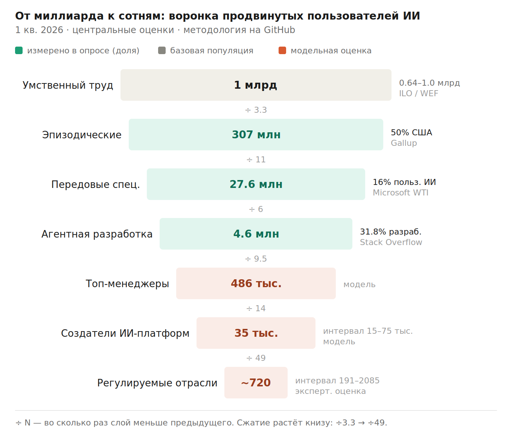

# AI Adoption Funnel

A reproducible, source-linked model of how AI usage narrows from ~1 billion knowledge workers down to a few hundred builders working under heavy regulation.

> **Core idea.** Half of US employees now use AI at work — but transformative usage (orchestrating agents, redesigning workflows) is concentrated in a vanishingly small cohort. AI amplifies the already-capable far more than it democratizes capability. This repo is the data and methodology behind that claim.



---

## What's here

| Path | Contents |
|------|----------|
| [`data/`](data/) | Primary metrics, source citations, historical quarterly series — all in machine-readable CSV/JSON plus the full annotated table |
| [`methodology/`](methodology/) | How the funnel is built: cascading filters, estimation taxonomy, Monte Carlo, sensitivity analysis, reviewer notes, known biases |
| [`src/`](src/) | Reproducible code — Monte Carlo simulation, sensitivity tables, figure generation |
| [`figures/`](figures/) | Generated charts (PNG + source SVG) |
| [`test/`](test/) | "AI Power User Index" — self-assessment to locate yourself in the funnel |

## The funnel at a glance (Q1 2026)

Strongest claims are **survey shares** (measured). Absolute counts are **model outputs** with widening uncertainty toward the bottom.

| Layer | Estimate | 90% CI | Class | Anchor |
|-------|----------|--------|-------|--------|
| Knowledge workers | 0.64–1.0B | 658M–983M | observed | ILO/UN, WEF/OECD |
| Occasional AI users | ~307M | 234–388M | derived | Gallup (50% US) |
| Frontier Professionals | ~27.6M | 19.0–37.7M | derived | Microsoft WTI (16%) |
| Agentic coders | ~4.6M | 3.4–6.1M | derived | Stack Overflow (31.8%) |
| C-level hands-on coders | ~486K | 236–808K | synthetic | BLS × Frontier × hands-on |
| AI builders | ~35K | 15–75K | scenario | cascading extrapolation |
| Regulated, emerging markets | ~720 | 191–2,085 | heuristic | expert estimate |

Full numbers, sources, and quarter-by-quarter history: [`data/`](data/).

## Reproduce it

```bash
# Monte Carlo (90% confidence intervals for every layer)
python src/monte_carlo_funnel.py

# Layer-3 sensitivity table (how the denominator choice swings the estimate)
python src/sensitivity_layer3.py

# Regenerate the funnel figure
python src/render_funnel.py
```

No dependencies beyond the Python standard library for the simulation; `cairosvg` for the funnel figure (see [`src/requirements.txt`](src/requirements.txt)).

## How solid are these numbers?

- **Top layers (shares)** — direct surveys, n > 115,000 combined. Solid.
- **Global extrapolation** — US data scaled by tiered regional multipliers. An assumption.
- **Bottom layers (counts)** — cascading model. A small change in the Frontier Professionals assumption moves the bottom layer ~8×. Intervals, not points.

Three caveats that travel with every number — vendor incentive to overstate, visibility bias toward developers/remote workers, and the fact that seven AI models reviewing this all read the same four upstream surveys (agreement ≠ independent confirmation). Details in [`methodology/biases.md`](methodology/biases.md).

## Versioning & updates

This is a **living model**. Upstream sources publish on a cadence (Gallup quarterly, Microsoft/McKinsey/Stack Overflow annually), so the funnel is meant to be refreshed, not frozen.

- Each data point in [`data/sources.csv`](data/sources.csv) carries its publication date and a `last_verified` field.
- The update cadence and procedure live in [`methodology/update-protocol.md`](methodology/update-protocol.md).
- Changes are tracked in [`CHANGELOG.md`](CHANGELOG.md) with semantic-style versions (`v1.x` = data refresh, `v2.0` = methodology change).

To propose a correction or add a source, open an issue or PR — see [`CONTRIBUTING.md`](CONTRIBUTING.md).

## Companion writing

- **AI stratification** — why generative AI didn't diffuse like smartphones: [habr.com/ru/articles/1027738](https://habr.com/ru/articles/1027738/)
- **Legacy migration with AI**: [habr.com/ru/articles/1038146](https://habr.com/ru/articles/1038146/)
- **The funnel piece** (this repo's writeup): *coming on Habr*

## License

- **Code** (`src/`): MIT — see [`LICENSE`](LICENSE)
- **Data & prose** (`data/`, `methodology/`, figures, writeups): CC BY 4.0 — attribution appreciated, corrections more so

Sources remain © their original publishers; this repo cites and links, never reproduces.
